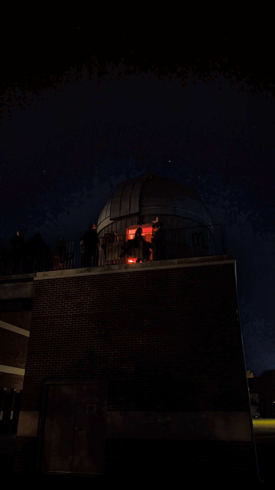
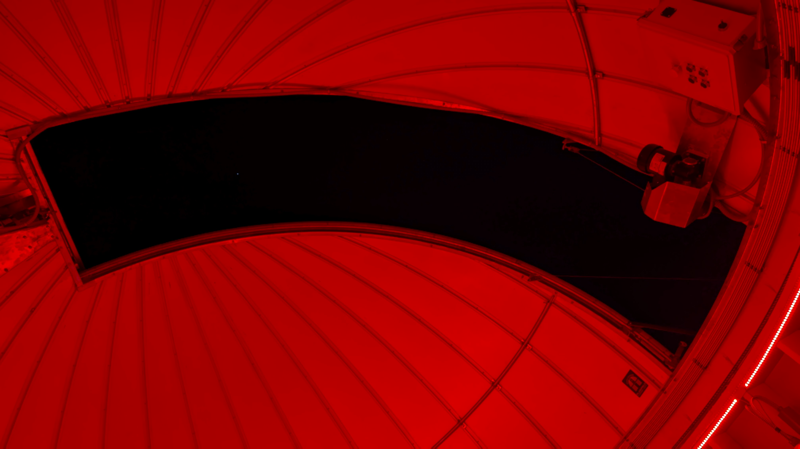
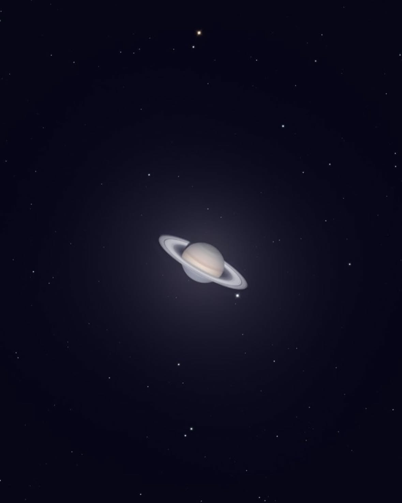
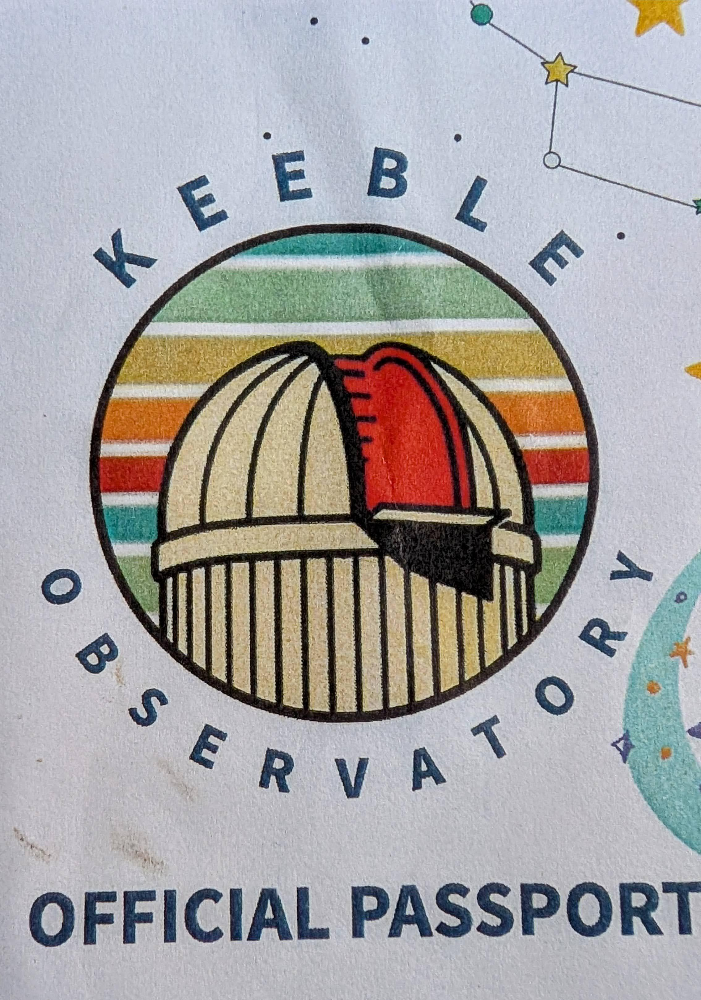
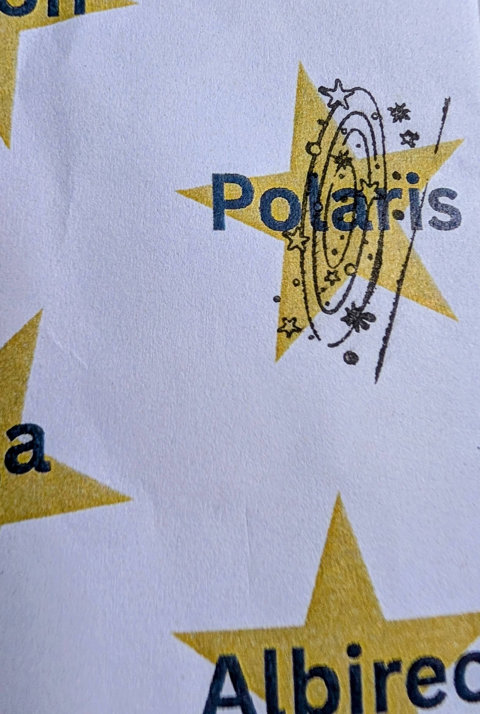

## 01. introduction

I headed up to Ashland on Thursday evening to check out the [Keeble Observatory](https://www.rmc.edu/about-rmc/offices-departments/physics-engineering-and-astrophysics/keeble-observatory/) at Randolph-Macon College. They open for public viewing on Thursday evenings through December, weather permitting. Since it was a beautiful, clear evening, it felt like the right time to go.

The observatory is easy to get to, although finding the actual entrance was a little tricky. When we arrived, the doors were locked. After some initial confusion about where to go, we managed to grab the attention of some students who let us inside. 

Because the weather was so nice, it was a little crowded. Even with waiting in line for the main telescope, the whole visit only took about half an hour. 

There were two things set up to view: the big observatory telescope inside the dome was pointed at Polaris, and a smaller telescope was set up outdoors pointed at Saturn. 

It was really cool being inside the observatory and checking out the main telescope, but in my opinion, the best part was the smaller telescope outside. I had never seen Saturn through a telescope so clearly. Wow, it looks just like what you see in images, rings and all. It was really nifty.

Before we left, the students handed out paper passports so if you return on future nights, you can get stamps for the things you have seen. Cool touch.

  

    
    
  

  
[fig: Keeble passport]

I think I will go back on another clear night in November to see more, as my interest is piqued on what else might be viewable over the next month or two. 

Overall, I give the Keeble Observatory an 8.5/10. Just make sure you hit it on a clear night.

---
