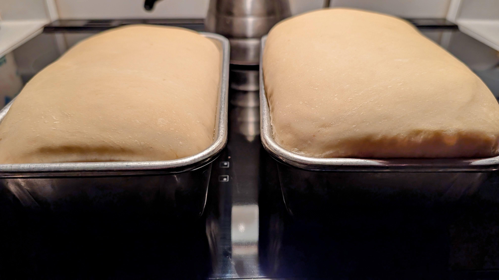
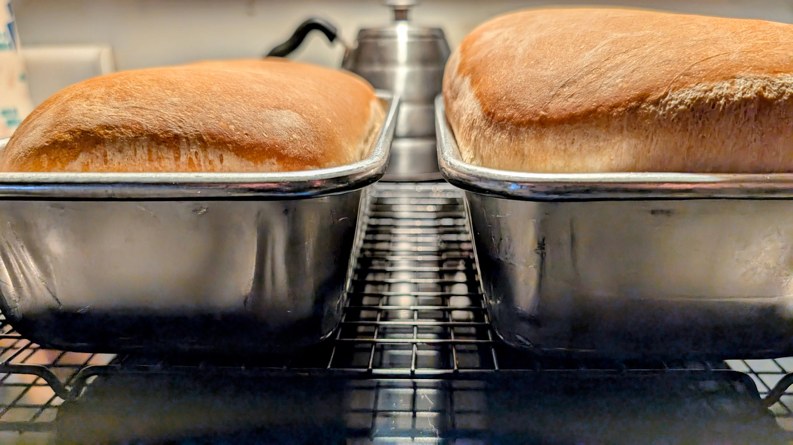
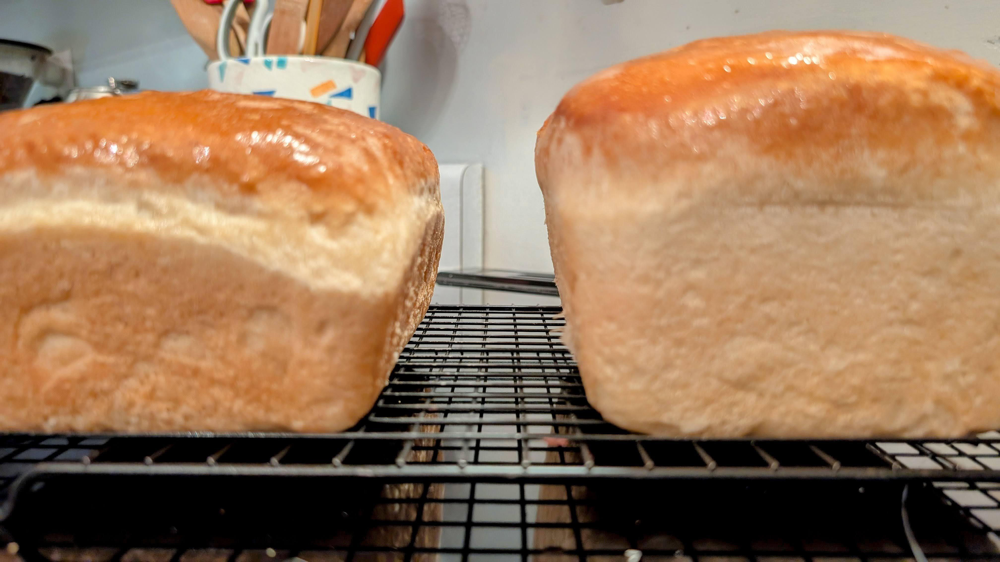
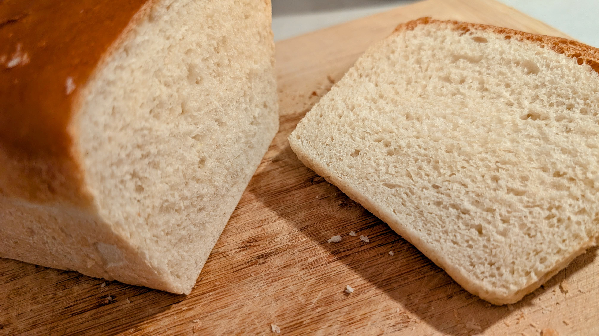

## 01. introduction

Back at it with another loaf (or two) following the trusty [Tastes Better from Scratch](https://tastesbetterfromscratch.com/bread-recipe/) baseline recipe. For this batch, I stuck with 100% [Hudson Cream Flour](https://www.hudsoncream.com/) and switched back to honey after using sugar last time.

### The Variable: Order of Operations & Mixing

For my variable this round, I changed up the order of how everything goes into the bowl. Normally, I throw the yeast, salt, honey, and other base ingredients in first, dump the initial flour on top, and then pour in the water last before starting the mix. This time, I put the initial flour in the bowl first and added everything else on top of it. 

I'm not sure if the order itself made a huge difference, but I've found that the *mixing* really does. It's wild, but it's true: the better the mix, the better the quality of the bread, and the less flour you end up using overall. You start out with three cups of flour and mix it extremely well, then add half a cup and mix thoroughly, then another half cup and mix again. Just like last time, taking the time to really work the dough meant I only needed six cups of flour total instead of seven.

### The Portioning Miscalculation

Everything was cruising along until it was time to divide the dough into the individual loaf pans for the second rise. I eyeballed the split and made a bit of a miscalculation. I didn't realize it at first, but one loaf ended up drastically smaller than the other. 

You can already see the size difference here during the second rise in the pans:

And once again, fresh out of the oven, it's pretty obvious which loaf got the short end of the deal:

Here they are all buttered up and cooling down:

### The Verdict

Despite the lopsided portioning, this batch turned out pretty well. It's very fluffy—just like a good, true white sandwich bread should be. It's not super hearty or thick, and it has a really nice sponge to it. The flavor is decent, too. I think I might actually like the honey batches a little more than the sugar ones, though the jury is still out on that. 

Other than my mistake making one loaf noticeably smaller than its sibling, I'm really happy with how these baked up.

**Rating:** 8.5/10

---

**Prior Bread Logs:**
* [Batch #1 - (Honey White Sandwich Bread)](https://binbot.dev/posts/baking-log-batch-1-honey-white-sandwich-bread.html)
* [Batch #2 - (Honey White Sandwich Bread)](https://binbot.dev/posts/baking-log-batch-2-honey-white-sandwich-bread.html)
* [Batch #3 - (Honey White Sandwich Bread)](https://binbot.dev/posts/baking-log-batch-3-honey-white-sandwich-bread.html)
* [Batch #4 - (White Sandwich Bread)](https://binbot.dev/posts/baking-log-batch-4-white-sandwich-bread.html)
* [Batch #5 - (White Sandwich Bread)](https://binbot.dev/posts/baking-log-batch-5-white-sandwich-bread.html)
---
