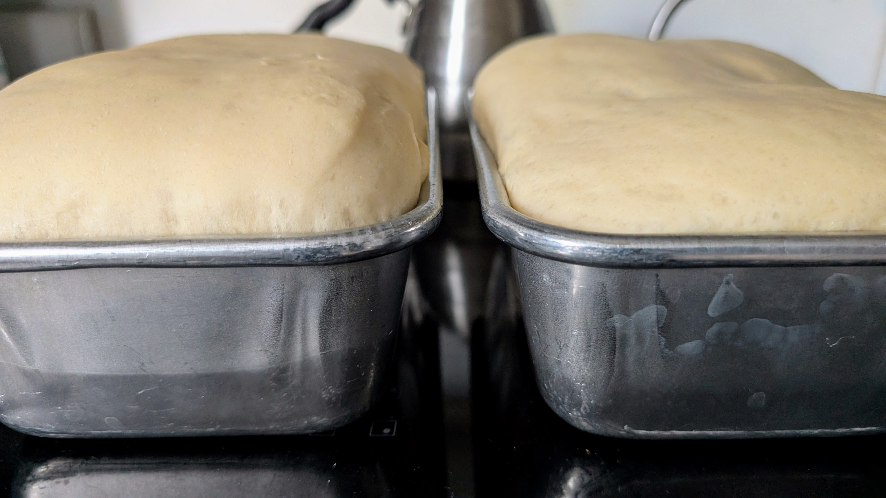
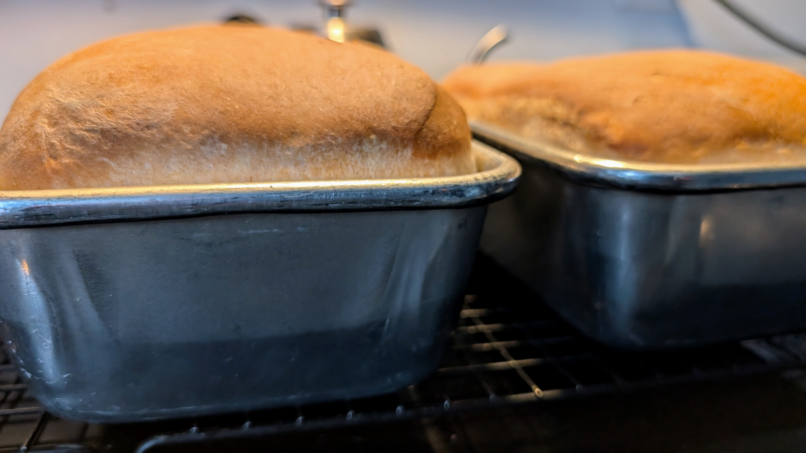
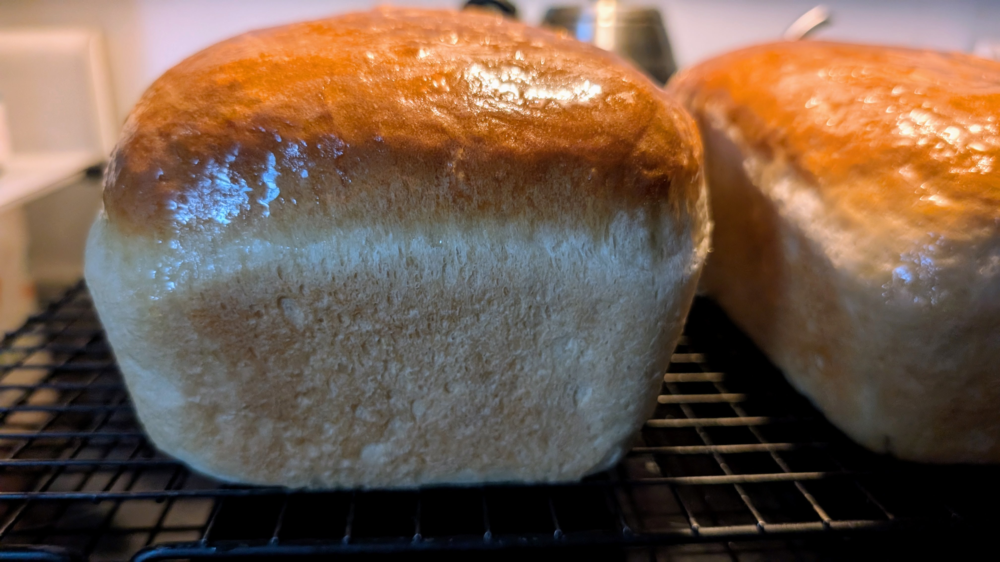
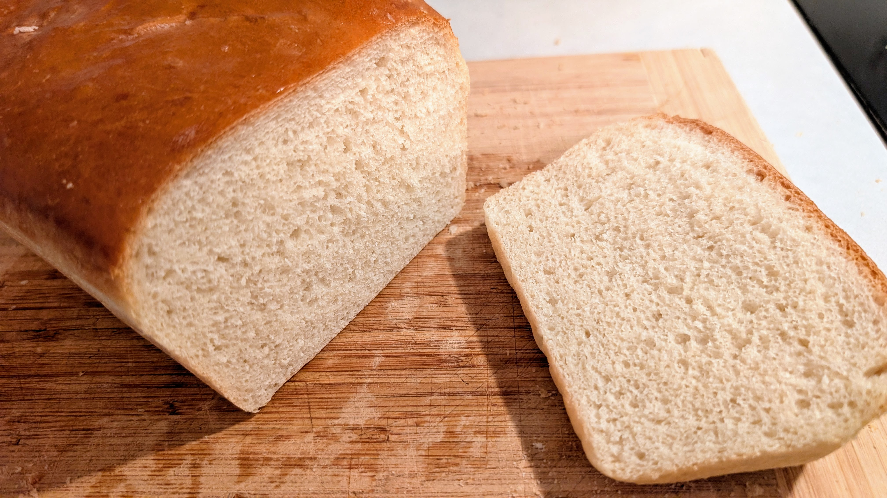

## 01. introduction

Time for another bread-log post! Here we are at **Batch #7** of the ongoing quest to dial in the ultimate white sandwich bread using the baseline [Tastes Better from Scratch](https://tastesbetterfromscratch.com/bread-recipe/) recipe, and for this batch we're back to 100% [King Arthur Flour](https://www.kingarthurbaking.com/).

If you want to catch up on the previous experiments in this series:
* [Batch #1 (Honey White Sandwich Bread)](https://binbot.dev/posts/baking-log-batch-1-honey-white-sandwich-bread.html)
* [Batch #2 (Honey White Sandwich Bread)](https://binbot.dev/posts/baking-log-batch-2-honey-white-sandwich-bread.html)
* [Batch #3 (Honey White Sandwich Bread)](https://binbot.dev/posts/baking-log-batch-3-honey-white-sandwich-bread.html)
* [Batch #4 (White Sandwich Bread)](https://binbot.dev/posts/baking-log-batch-4-white-sandwich-bread.html)
* [Batch #5 (White Sandwich Bread)](https://binbot.dev/posts/baking-log-batch-5-white-sandwich-bread.html)
* [Batch #6 (Honey White Sandwich Bread)](https://binbot.dev/posts/baking-log-batch-6-honey-white-sandwich-bread.html)

---

### The Variables

Along with returning to 100% King Arthur Flour, I switched up the sweetener for this batch and introduced [Zulka Pure Cane Sugar](https://zulkasugar.com/producto/zulka-pure-cane-sugar/) rather than regular granulated sugar. To be honest, I'm not sure if the brand or cane sugar type actually makes a difference. I don't know much about sugar, but I bought it on a whim and thought I'd try it.

It's also getting a bit chillier these days in my already chilly kitchen, so I stuck my proofing bowl and baking tins on the oven to get them ready while I was mixing. Maybe this counts as a second variable: pre-heating the mixing bowl and baking tins to **95°F** (bread proof temp) so the dough doesn't touch a chilly surface.

### The Rise

I'm not sure if the cane sugar or the pre-heating helped, but the first rise turned out fine. It just took a little longer than the usual 2 hours, clocking in at **2.5 hours**. The second rise was similar: usually around an hour, but this time it took **1.5 hours**. Even with the slower pace, they looked great.

### The Bake & Results

Once the bake was done, they came out looking nice and healthy:

And here they are beautifully buttered:

Very positive results this time. The outer crust is near perfect, not too chewy, but noticeable and full of flavor. The inner texture is light and fluffy. I'd say these are dang near perfect, though maybe I always say that. Anyway, they taste great. Was it the sugar, the King Arthur flour, or both? Stay tuned for more adventures.

Obligatory crumb shot on the board:

### Rating: **9/10**

---

